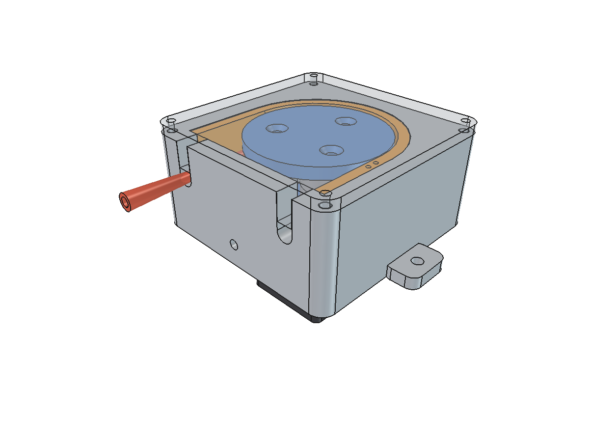
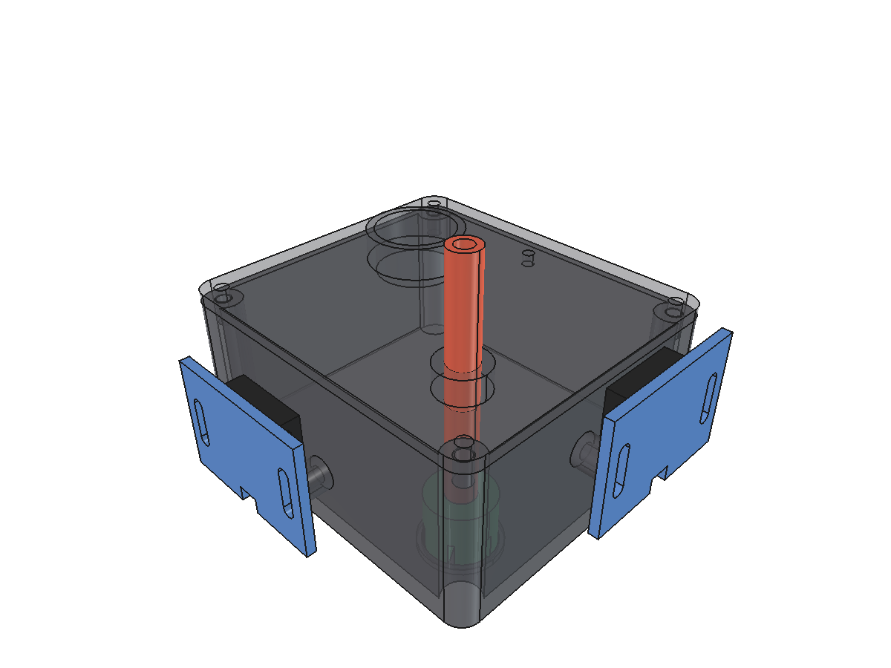

# Quiet condensate pump

A slow, quiet peristaltic pump that lifts AC condensate ~40 cm and replaces a
noisy Masterflow 20. It uses a stepper, a TMC2209 and an ESP32-C3; two
non-contact level sensors on a 3D-printed reservoir drive an adaptive flow
control; and it reports to Home Assistant over MQTT.

| | |
|---|---|
|  |  |

- **[docs/design.md](docs/design.md)**: requirements, sizing, control
  strategy, decisions and open questions. This is the single source of truth.
- **[docs/electronics.md](docs/electronics.md)**: perfboard layout,
  connections, BOM, bring-up.
- **[docs/assembly/](docs/assembly/README.md)**: LEGO-style assembly
  instructions ([PDF](docs/assembly/assembly_instructions.pdf)).
- **[cad/](cad/README.md)**: parametric FreeCAD models, with print lists and
  hardware. Rebuild everything with `cad/build.sh`.
- Firmware (Zephyr + MQTT + HA discovery) is still to come.

Status: prototype v1 is designed. Nothing has been printed yet.
