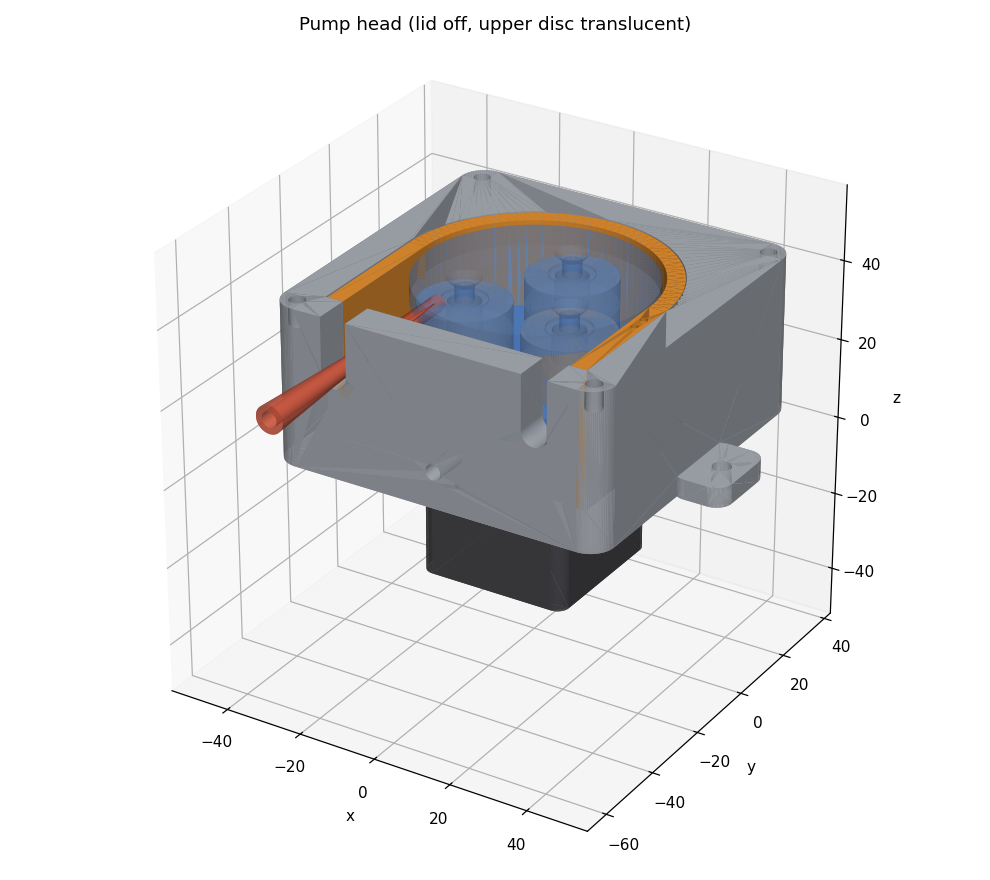
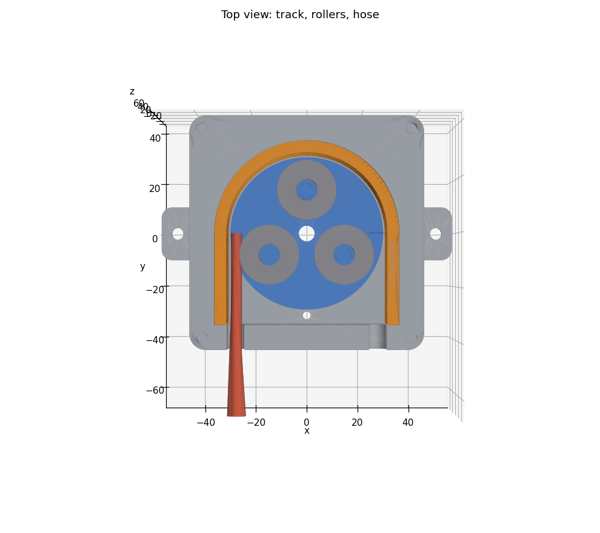
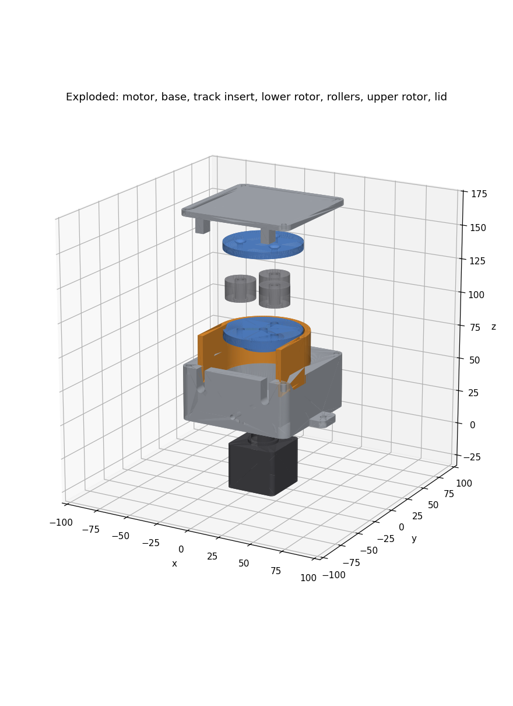
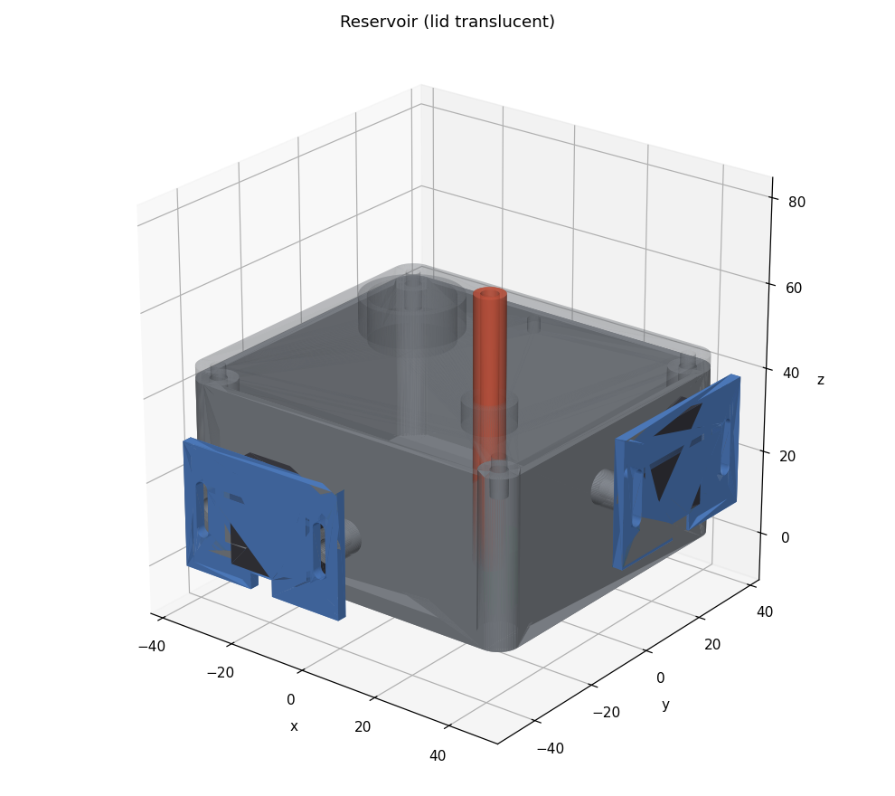
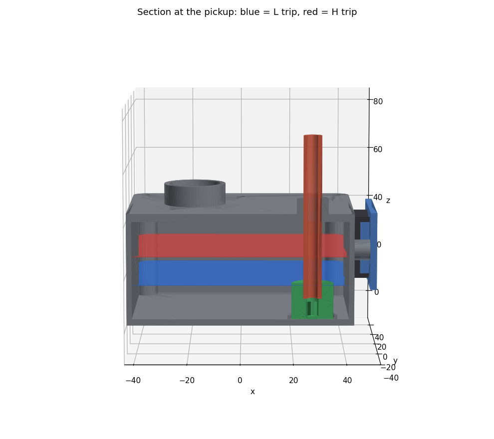

# CAD — pump head and reservoir (v1)

Parametric FreeCAD models generated by Python. **Edit `params.py`, then run
`cad/build.sh`.** Every part, the STEP/STL exports, the assembly `.FCStd`
files and the preview PNGs in `cad/out/` are regenerated, and the
interference checks run.

```sh
cad/build.sh              # both
cad/build.sh pump         # pump head only
cad/build.sh reservoir    # reservoir only
```

The build uses `~/bin/FreeCAD_1.1.1-Linux-x86_64-py311.AppImage`. Override it
with `FREECAD=/path/to/AppImage`. Open `out/pump_assembly.FCStd` or
`out/reservoir_assembly.FCStd` in FreeCAD to inspect the assemblies; objects
named `ref_*` are reference parts and are not printed.

| File | What |
|------|------|
| `params.py` | all dimensions (mirrors `docs/design.md`) |
| `cadlib.py` | primitives, export, interference checks, matplotlib preview renderer |
| `pump.py` | pump head: base, track inserts, rotor, sleeves, lid |
| `reservoir.py` | reservoir: body, lid, strainer cage, sensor clip |
| `run.py` | runner (`freecadcmd` doesn't set `__name__ == "__main__"`) |
| `out/` | generated: `*.stl`, `*.step`, `*_assembly.FCStd`, `*.png` |

## Pump head



| | |
|---|---|
|  |  |

### Print list (PETG)

| Part | Qty | Orientation / notes |
|------|-----|---------------------|
| `pump_base` | 1 | floor down. Motor bolts underneath, rotor and track sit inside |
| `pump_track_insert_gap2p4` / `2p6` / `2p8` | 1 each | upright. Print all three for the first test; the dimples on the +x leg mark 1 / 2 / 3 |
| `pump_rotor_lower_stock` | 1 | **disc face down** (clamp up). Use `…_nema17` if the motor is swapped |
| `pump_rotor_upper` | 1 | flat face down (countersinks on the bed are fine at 45°, bosses up) |
| `pump_axle_sleeve` | 3 | flange down. Fine layers; it must slide into the 608 bore (Ø7.95) |
| `pump_lid` | 1 | top face down (hose tabs up) |

### Hardware

| Item | Qty | Use |
|------|-----|-----|
| 608 bearing (8×22×7) | 6 | 3 rollers × 2 stacked |
| M4 × 25 countersunk (DIN 7991) | 3 | roller axles |
| M4 heat-set insert (Ø5.6 hole) | 3 | lower rotor disc |
| M3 grub screw × 8 + M3 nut | 2 + 2 | rotor clamp on the motor hub (captive nuts) |
| M3 × 8 | 4 | motor → base (31 mm square) |
| M3 × 10 + M3 heat-set insert | 4 + 4 | lid |
| 4×7 silicone hose | 1 run | continuous from the reservoir pickup to the drain |

### Assembly

1. Press the M3 heat-set inserts into the 4 wall tops of the base, and the M4
   inserts into the lower rotor disc (from the top face).
2. Bolt the motor under the base with 4× M3×8. Its Ø22 boss sits in the
   Ø23 × 2.5 pocket.
3. Rollers: for each one, slide a sleeve (flange down) through 2 stacked 608
   bearings and stand it on an M4 insert.
4. Put the upper disc on (its bosses go on the top bearings' inner races) and
   tighten the 3× M4 countersunk bolts until the rollers spin freely with no
   axial play.
5. Drop the nuts into the slots under the clamp, slide the rotor over the motor
   hub, and tighten the 2 grub screws through the Ø4 access hole in the -y
   wall, rotating the rotor between them.
6. Drop in a track insert (start with **2.6**). Lay the hose around the
   rollers. Its legs go into the two U-saddles in the -y wall, with the
   **inlet on the -x side if the motor turns counter-clockwise when seen from
   above**.
7. Fit the lid: its tabs press the hose into the saddles, which stops the hose
   creeping. Fix it with 4× M3×10.

**Torque test** (design.md §3.3): with water in the hose, push a 100 mm lever
on the upper disc with a kitchen scale; T = F · 0.1 m. Swap the 2.4 / 2.6 /
2.8 inserts and keep the loosest one that does not slip against the 0.4 m
lift.

## Reservoir

| | |
|---|---|
|  |  |

### Print list (black or dark PETG, because light grows algae)

| Part | Qty | Orientation / notes |
|------|-----|---------------------|
| `reservoir_body` | 1 | floor down. **Watertight walls: use ≥ 5 perimeters (the 2 mm wall is fully perimeters), 100 % infill on the floor**, and test-fill it with water before use |
| `reservoir_lid` | 1 | flat side on the bed, collars up. No supports needed |
| `reservoir_strainer` | 1 | socket up |
| `reservoir_sensor_clip` | 2 | flat plate on the bed |

### Hardware

| Item | Qty | Use |
|------|-----|-----|
| M3 × 8 + M3 heat-set insert | 4 + 4 | lid → corner columns |
| M3 × 8 + M3 heat-set insert | 4 + 4 | sensor clips → wall bosses (blind, the wall is not pierced) |

### Notes

- The sensors sit flat against the 2 mm wall: **L on the -y wall, H on the
  +x wall**. Their trip lines are at 13 / 24 mm above the inside floor. The
  clip slots give ±5 mm of adjustment once you find the sensor's real trip
  line.
- Measured from the model:
  - 65 mL between L and H;
  - 77 mL that is always wet below L;
  - only **~80 mL (≈ 3 min at 1.5 L/h) between H and the lid**.
- The pickup hose enters through the lid collar and plugs into the strainer
  cage. Nothing passes through the walls below the water line.
