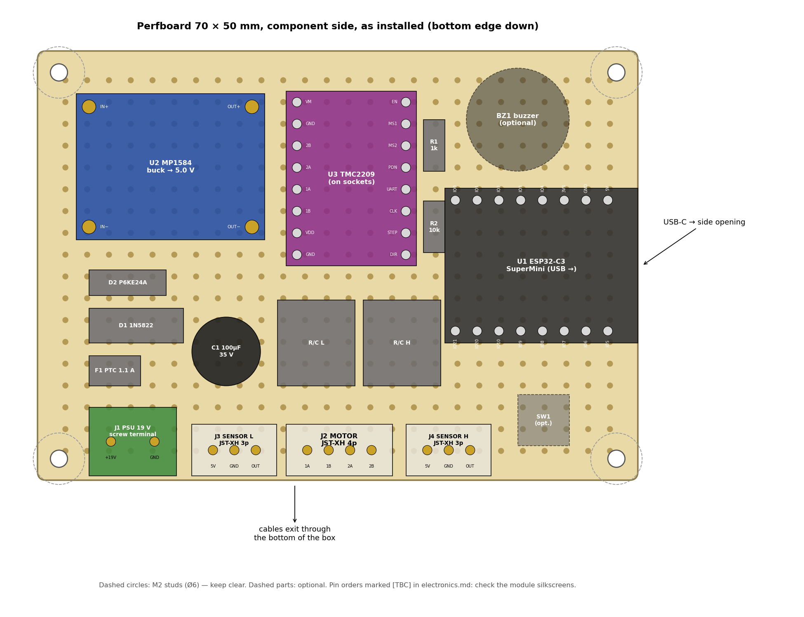

# Electronics: perfboard and housing (prototype v1)

Companion to [design.md](design.md) §5 (electronics concept) and §6
(control). The build steps with pictures are in
[assembly/](assembly/README.md), steps 15–18.

## 1. Overview

```
 PSU 19 V ──J1──F1──D1──┬──────────────── VIN (19 V) ──────────┬────────────┐
 (bare wires)  PTC  1N5822│ D2 P6KE24A (TVS)   C1 100µF/35V     │            │
                        GND                                    U3 VM      U2 IN+
                                                               TMC2209    MP1584 ──► +5 V
                                                                  │          (set 5.0 V!)
                ┌────────────── 3V3 ◄── U1 ESP32-C3 ◄── +5 V ─────┼──────────────┤
                │                    IO3 STEP, IO4 DIR, IO5 EN    │              │
                └──► U3 VDD          IO6 ─1k─┬─ PDN_UART          │        J3 / J4 sensors (5 V)
                                     IO7 ────┘                    │        OUT ─► R/C ─► IO0 / IO1
                                                        J2 ◄── 1A 1B 2A 2B
```

- **Board**: a standard **5 × 7 cm perfboard** (2.54 mm grid, double-sided
  FR4 recommended), mounted in landscape with the bottom edge facing down.
  - The 4 corner holes take **M2 × 6 self-tapping screws** into printed
    studs.
  - The hole inset (2.5 mm) and hole size are **[TBC]**: measure your board
    and change `PERF_HOLE_INSET` / `PERF_HOLE_D` in `cad/params.py`.
- **Modules on sockets**: the ESP32-C3 SuperMini and the TMC2209 sit in
  **female headers**, so they can be swapped. The MP1584 is soldered with pin
  headers.

## 2. Housing

- **Size and placement**: 91 × 35 × 59 mm (W × D × H). It bolts to the
  **back (+y) wall of the pump head** with 2× M3 × 8 from inside the box into
  heat-set inserts. Its top is flush with the pump lid, and its bottom is above
  the motor's bottom face.
- **Openings point down or sideways, never up**:
  - **4 cable holes in the bottom**, one under each connector: J1 Ø6.5,
    J3 Ø5, J2 Ø6, J4 Ø5;
  - **USB-C** through the +x side wall;
  - **vent slots** in the front lid, in front of the TMC2209.

  Drips run past the box, not into it. Leave a drip loop in every cable.
- **Lid**: 4× M3 × 10 into heat-set inserts in two side pillars. The pillars
  are outside the board's footprint, so the board slides in from the front.
- **Mounting elsewhere**: the same 2 back holes (40 mm apart) can be screwed
  to a wall, or to any bracket with M3 inserts 40 mm apart. The reservoir's
  2 mm walls are too thin for inserts, which is why the pump head is the
  default host.
- CAD: `cad/electronics.py`, which produces `electronics_box`,
  `electronics_lid` and `electronics_assembly.FCStd`. All 10 interference
  checks pass, including "board slides in past the pillars".

## 3. Layout



Generated by `cad/pcb_layout.py` from `PCB_PARTS` in `cad/params.py`. The
housing's cable holes and USB opening are placed from the same table, so they
always line up.

**Pin orders marked [TBC] must be checked against the silkscreen of your
modules before soldering:**
- **ESP32-C3 SuperMini, USB pointing right.**
  - Top row from the USB end: 5V, GND, 3V3, IO4, IO3, IO2, IO1, IO0.
  - Bottom row from the USB end: IO5, IO6, IO7, IO8, IO9, IO10, IO20, IO21.
- **TMC2209 StepStick, EN/VM end at the top.**
  - Left row: VM, GND, 2B, 2A, 1A, 1B, VDD, GND.
  - Right row: EN, MS1, MS2, PDN, UART, CLK, STEP, DIR.
  - Some modules label the two UART pins RX/TX or PDN/UART; on the TMC2209
    they are the same PDN_UART line.

## 4. Connections

| Net | From → to | Notes |
|-----|-----------|-------|
| +19V_IN | J1.1 → F1 → D1 anode | F1 = PTC resettable fuse 1.1 A hold, ≥ 30 V (e.g. MF-R110) |
| VIN (≈ 18.6 V) | D1 cathode → D2 cathode, C1 +, U3 VM, U2 IN+ | D1 = reverse-polarity protection (Schottky, 0.4 V drop) |
| GND | J1.2, D2 anode, C1 −, U3 GND ×2, U2 IN− / OUT−, U1 GND, J3.2, J4.2, R/C grounds | one star point near C1 |
| +5V | U2 OUT+ → U1 5V, J3.1, J4.1, (BZ1 +) | **set U2 to 5.0 V before connecting anything to it** |
| 3V3 | U1 3V3 → U3 VDD, R2, (sensor pull-ups if NPN) | |
| STEP | U1 IO3 → U3 STEP | |
| DIR | U1 IO4 → U3 DIR | |
| EN | U1 IO5 → U3 EN, **R2 10 k to 3V3** | active-low: the pull-up keeps the motor off while the ESP32 boots |
| UART TX | U1 IO6 → **R1 1 k** → U3 PDN_UART | phase 2 (software current etc.). Wire it now anyway |
| UART RX | U1 IO7 → U3 PDN_UART | |
| MS1, MS2 | leave open | internal pull-downs → 8 µsteps, 256 interpolated (design.md §5.1) |
| Motor | U3 1A, 1B, 2A, 2B → J2.1–4 | 1A/1B = one coil, 2A/2B = the other. Find the pairs with a multimeter (≈ low Ω within a coil) |
| Sensor L | J3.3 OUT → R/C L → U1 IO0 | see §5 |
| Sensor H | J4.3 OUT → R/C H → U1 IO1 | see §5 |
| Buzzer (opt.) | +5V → BZ1 → NPN (BC547) collector; base ← 1 k ← U1 IO20; emitter → GND | active 5 V buzzer |
| Button (opt.) | U1 IO21 → SW1 → GND | internal pull-up; manual purge / test |

GPIO2, 8 and 9 are boot-strapping pins, and IO8 also drives the on-board
LED, so they are deliberately unused.

## 5. Sensor input network (R/C L, R/C H)

Each sensor input has the same footprint. Fit the parts for **your** sensor's
output type (design.md Q2, still open):

```
 OUT ──┬── Rs 10k ──┬────► IO0 / IO1
       │            ├── C 100 nF ── GND
     Rpu 10k        └── Rb 20k ── GND
       │
      3V3
```

| Sensor output | Rpu (to 3V3) | Rs | Rb | C |
|---------------|--------------|----|----|---|
| **NPN / open collector** | **fit** | fit | **omit** | fit |
| **Push-pull "V" output = 5 V** | omit | fit | **fit** (5 V → 3.3 V) | fit |
| **PNP** (switches to 5 V) | omit | fit | fit | fit |

Rs + C form a ~1 ms filter. Add a ~2 s software debounce in the firmware
against ripples on the water surface (design.md §5.3).

## 6. Bill of materials

| Ref | Part | Qty | Notes |
|-----|------|-----|-------|
| U1 | ESP32-C3 SuperMini | 1 | on 2× 8-pin female headers |
| U2 | MP1584EN buck module | 1 | 28 V max input. Not a mini-360 (23 V max) |
| U3 | TMC2209 StepStick module + heatsink | 1 | on 2× 8-pin female headers |
| F1 | PTC fuse 1.1 A hold, 30 V (MF-R110) | 1 | |
| D1 | 1N5822 Schottky 3 A | 1 | reverse polarity |
| D2 | P6KE24A TVS (through-hole) | 1 | through-hole replacement for the SMBJ22A in design.md |
| C1 | 100 µF 35 V electrolytic (low-ESR) | 1 | right at U3 VM |
| R1 | 1 k | 1 | UART |
| R2 | 10 k | 1 | EN pull-up |
| Rs, Rb, Rpu | 10 k / 20 k / 10 k | 2 sets | per §5 |
| C | 100 nF | 2 | sensor filters (+ 1 at U1 5V recommended) |
| J1 | 2-pin screw terminal 5.08 mm | 1 | PSU wires |
| J2 | JST-XH 4-pin header + plug | 1 | motor |
| J3, J4 | JST-XH 3-pin header + plug | 2 | sensors |
| BZ1, SW1 | active buzzer + BC547 + 1 k, tactile switch 6×6 | opt. | |
| — | 5 × 7 cm perfboard, female headers, wire | 1 | |
| — | M2 × 6 self-tapping | 4 | board → studs |
| — | M3 × 8 + M3 × 10, M3 heat-set inserts | 2 + 4, 4 | box → pump, lid → box |

## 7. Bring-up (do it in this order)

1. **Before the modules go in**, power J1 from the PSU and check the polarity
   and voltages:
   - D1 blocks if the wires are swapped (no voltage on VIN);
   - VIN should be about 18.6 V.
2. **Set the MP1584 to 5.0 V** with its trimpot, measured at OUT+. Brand-new
   modules can come set to anything up to the input voltage, which would kill
   the ESP32.
3. Fit the ESP32. The 19 V supply now powers it through the 5 V pin.
   - **Don't connect USB and the 19 V supply at the same time** until you've
     checked whether your SuperMini has a diode between VBUS and its 5V pin.
     Without one, the USB port and the MP1584 drive the same rail.
4. **Set the TMC2209 current** (design.md §3.3), with the motor *disconnected*
   and VM and VDD powered:
   - measure VREF between the pot wiper and GND;
   - on a 0.11 Ω-sense module, I_RMS ≈ 0.71 × VREF;
   - start at **0.4 A → VREF ≈ 0.56 V**.
5. Power off, plug in the motor (**never plug or unplug the motor while the
   driver is powered**), then fit the TMC2209.
6. Sensors: plug J3/J4. Check IO0/IO1 with a finger or a glass of water
   against the wall.
7. Close the lid. Keep the cables low, with drip loops.
